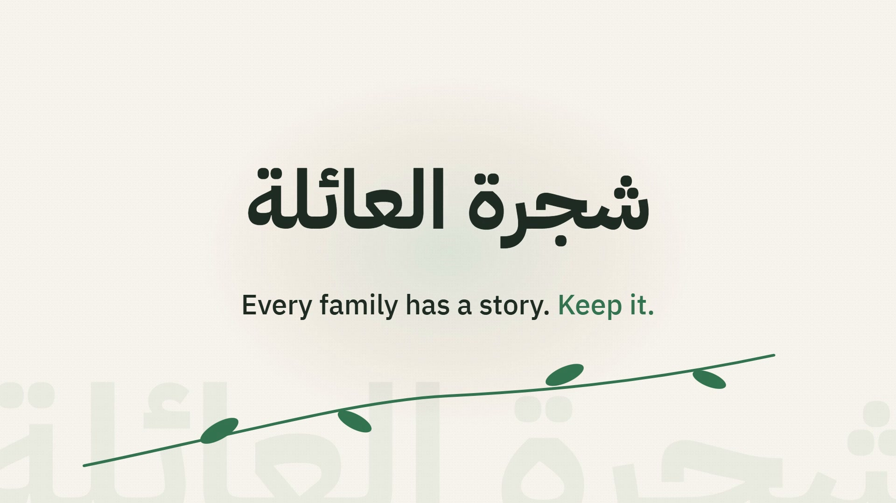

# Family Tree (شجرة العائلة)

A family-tree app that speaks Arabic first (plus English and French). Add relatives and watch the generations fill in. Search by relation, including in Arabic: جدة finds the grandmother. It also reminds you of birthdays, imports and exports GEDCOM, and backs up your whole tree in one file. It runs as a Windows desktop app, a self-hosted Docker container, or a split web deployment.

[](brag-output/familyTree.mp4)

*Click the image to watch the 40-second demo video.*

**Stack:** Django REST Framework · React + Vite · d3 / three.js · Motion · Electron · Docker · SQLite or Postgres

## Development

Backend (Django):

- Run in a Python virtualenv and install dependencies:

```bash
python -m venv env
env\Scripts\activate   # Windows
pip install -r requirements.txt
```

- Run migrations and start server:

```bash
python manage.py migrate
python manage.py runserver
```

Frontend (React, Vite):

```bash
cd familytree_front
npm install
npm run dev
```

The project uses `.env` at the repository root for `SECRET_KEY`, `DEBUG`, and `DATABASE_NAME`.

Birthday notifications:

- There's a management command to list today's birthdays (placeholder for sending emails):

```bash
python manage.py send_birthday_notifications
```

Media uploads:

- Uploaded photos are stored in the `media/photos/` directory. In development the files are served automatically when `DEBUG=True`.


## Docker (hosted web version)

One container serves the web UI, the API and uploaded photos. Data (SQLite database and photos) lives in the `familytree-data` volume, so it survives rebuilds.

1. Create your settings:

   ```bash
   cp .env.example .env
   python -c "import secrets; print(secrets.token_urlsafe(48))"   # run twice: one value per secret
   ```

   Put one value in `DJANGO_SECRET_KEY` and the other in `FAMILYTREE_API_TOKEN`.

2. Start it:

   ```bash
   docker compose up -d --build
   ```

3. Open `http://localhost:8000/?token=<FAMILYTREE_API_TOKEN>` once. The browser remembers the token, so afterwards `http://localhost:8000/` is enough.

**Security.** The app has no user accounts: the token is the only lock, and anyone who has it can read and change the tree. Uploaded photos under `/media/` are not behind the token. By default the port is published on `127.0.0.1` only. To use it from other devices:
- put an HTTPS reverse proxy (Caddy, nginx, Traefik) in front of it
- add your hostname to `DJANGO_ALLOWED_HOSTS`
- change the port mapping in `compose.yaml`

Never expose it over plain HTTP on the internet.

Other useful commands:

```bash
docker compose logs -f                                     # server output
docker compose down                                        # stop (data is kept)
docker compose exec familytree python manage.py createsuperuser   # Django admin at /admin/
```

Backups: use **Export Tree** in the app, or copy the volume.
